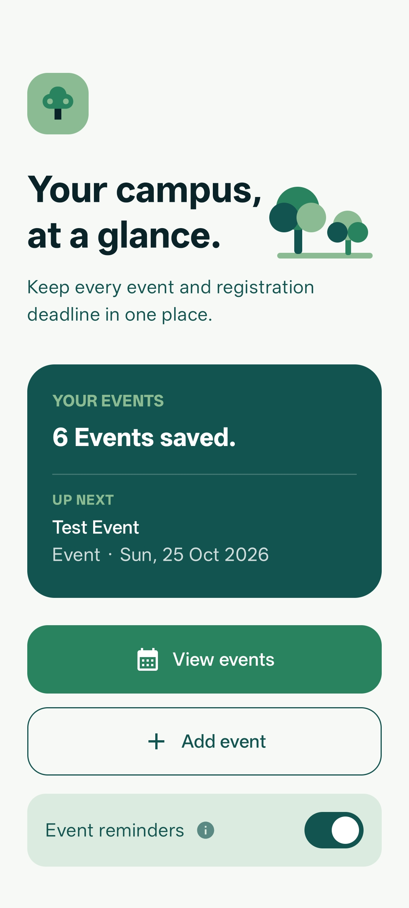
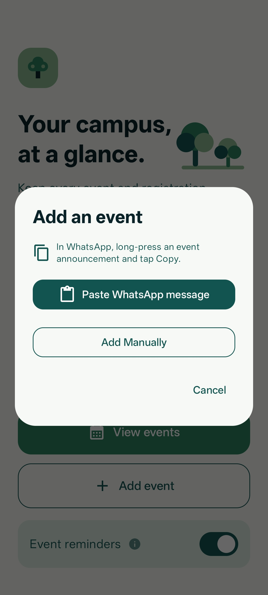
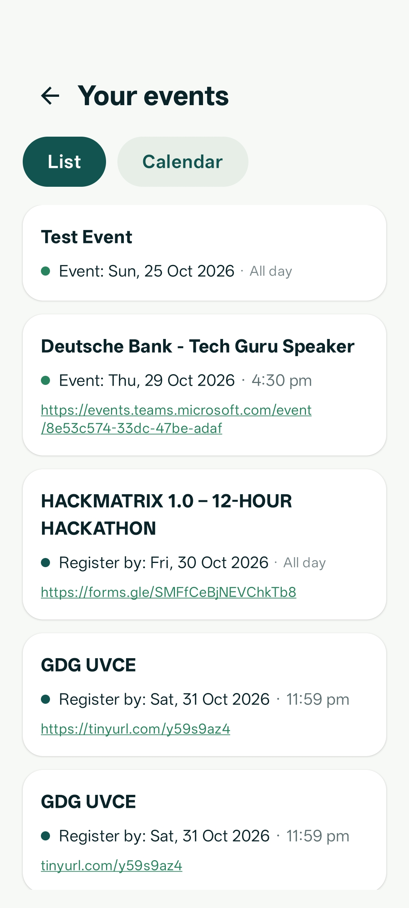
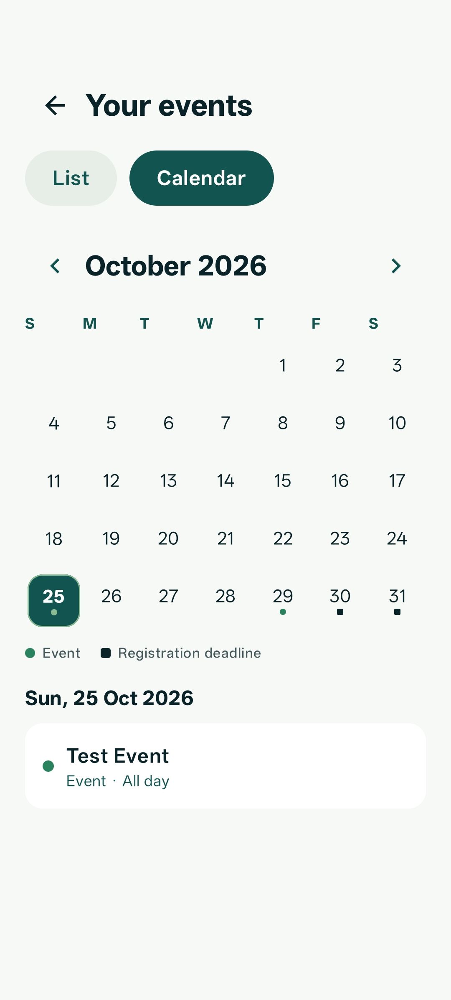

# TreeTrack 🌳

TreeTrack helps you organize campus events, registration deadlines, and registration links in one place.

## Features

- Paste a WhatsApp announcement and review suggested event details before saving.
- Detects event and deadline dates, nearby times, and registration links.
- Skips YouTube links and prefers links labeled for registration or forms.
- Set optional local reminders for saved event dates and registration deadlines:
  - 9:00 AM the day before
  - 7:00 AM on the date
- View events in a list sorted by the next active date or in a calendar.
- Move registration-closed events with no event date into a separate pending-date section; when an event date is added, sort the event back into the main list.
- Automatically remove events after their event date has passed.
- Edit or delete saved events, and add personal notes.
- Tap a registration link to open it, or long-press it to copy it.
- Keep events on your device; no account or backend is required.

## Screenshots

| Home | Add an event |
| --- | --- |
|  |  |

| Event list | Calendar |
| --- | --- |
|  |  |

Announcement parsing is not 100% accurate, so check suggested details before saving. Reminders require notification permission and a saved date.

## Getting started

1. Install [Android Studio](https://developer.android.com/studio).
2. Open this project in Android Studio and sync Gradle.
3. Use Java 17 and install the Android SDK requested by Android Studio.
4. Select an emulator or connected Android device and press **Run**.

## Project details
- Kotlin and Jetpack Compose
- Minimum Android version: Android 8.0 (API 26)
- Current app version: 4.1
- Events are stored locally on-device

### Download
Download the [latest TreeTrack APK](https://github.com/Synergy1610/Event-Tracker/releases/latest) from GitHub Releases.

### License
MIT
